# DailyViral

[](https://github.com/ftuchsch/DailyViral/actions/workflows/ci.yml)

A Python automation pipeline for scheduling Instagram Reels, rendering rotating
text overlays with FFmpeg, and publishing through the official Meta API. It
supports a persistent local queue and a stateless GitHub Actions deployment.
The cloud pipeline uses private Cloudflare R2 storage for both source and
rendered videos.

## Features

- A SQLite queue with scheduled dates, publication states, failures, and media IDs.
- Daily captions that continue from the latest successful Instagram post, so
  failed scheduled runs do not advance the series.
- CSV-driven overlay selection, FFmpeg rendering, and bounded execution times.
- Private R2 source downloads and short-lived, GET-only links to rendered videos.
- Public-access verification before R2 downloads and uploads; publication fails
  when bucket privacy cannot be verified.
- Duplicate-caption checks and serialized scheduled runs.
- Preview mode and explicit publishing switches.
- Credential redaction, pinned dependency hashes, secret scanning, vulnerability
  audits, formatting, linting, and regression tests.

## Architecture

```mermaid
flowchart LR
    A[GitHub schedule or manual run] --> B[Preview and publishing gates]
    B --> C[Read recent Instagram captions]
    C --> D[Resolve next series number]
    D --> E[Verify R2 public access is disabled]
    E --> F[Download private source video]
    F --> G[Render CSV overlay with FFmpeg]
    G --> H[Upload private temporary object]
    H --> I[Generate short-lived GET link]
    I --> J[Meta fetches and processes video]
    J --> K[Publish Reel]
    K --> L[Delete temporary object and local files]
```



Cleanup also runs when publication fails. A bucket lifecycle rule is the backup
for runner crashes or cancellations. A signed link authorizes anyone who has it
to read **one object** until expiry; it does not authorize listing the bucket or
writing objects. The code never prints those links as ordinary diagnostics.

**Private storage still requires account configuration.** This repository cannot
disable an existing public Cloudflare endpoint, revoke old credentials, or audit
all Workers and Pages bindings. Before making a deployment public, complete
[the publication checklist](SECURITY.md#before-making-the-repository-public).
No project can promise zero risk. If you require absolutely no third-party
access to any video, leave publishing disabled: Instagram must fetch a video to
publish it.

## Requirements

- Python 3.11 or newer.
- FFmpeg with the `drawtext` filter for overlay publishing.
- An Instagram professional account and a Meta application configured for the
  official content-publishing API.
- A private R2 bucket in the default jurisdiction for cloud publishing.

DailyViral defaults to `https://graph.instagram.com` and API version `v23.0`.
Confirm that the version and permissions match your Meta application before
publishing. See [Instagram Platform documentation](https://developers.facebook.com/docs/instagram-platform/)
and [content publishing](https://developers.facebook.com/docs/instagram-platform/content-publishing/).
The client also accepts the official Facebook Graph origin, but the automated
long-lived token refresh targets the Instagram Login flow. Use a compatible
Instagram Login token for the scheduled deployment.

## Local setup

```bash
git clone https://github.com/ftuchsch/DailyViral.git
cd DailyViral
python3 -m venv .venv
source .venv/bin/activate
python -m pip install --require-hashes --only-binary=:all: -r requirements.txt
cp .env.example .env
chmod 600 .env
python -m dailyviral init
```

Edit `.env` and the generated `config/accounts.yaml`. Each account refers to an
environment variable containing its token; tokens do not belong in account YAML.
The examples contain no real credentials. Private configuration, local logs,
databases, generated videos, and virtual environments are ignored by Git.
Ignoring a file does not remove it from existing commits.

The supplied switches keep new installations in preview mode:

```dotenv
AUTO_POST_ENABLED=false
CONFIRM_BEFORE_POSTING=true
DRY_RUN=true
```

Existing environment variables take precedence over `.env`. The CLI reads
`.env` for local use; GitHub runners use the environment supplied by the workflow.

### Local queue commands

```bash
# Verify an account and its configured direct video link.
python -m dailyviral check-config main_meme_account

# Add a post interactively or from a JSON document.
python -m dailyviral add --account-name main_meme_account
python -m dailyviral add-from-file data/new_post.example.json

# Schedule a sequence using DAILYVIRAL_VIDEO_URL from .env.
python -m dailyviral schedule-days main_meme_account --days 7 --start-date 2026-10-01

# Inspect the queue before publishing.
python -m dailyviral dry-run main_meme_account
python -m dailyviral upcoming main_meme_account
python -m dailyviral status
python -m dailyviral analytics

# These respect publishing switches and confirmation settings.
python -m dailyviral post-next main_meme_account
python -m dailyviral run-due main_meme_account
python -m dailyviral posted main_meme_account
```

Local queue mode stores its URLs in an ignored SQLite database. Its video links
must use HTTPS on port 443 and resolve exclusively to public IP addresses.
Every redirect is checked and connections use the validated IP to prevent DNS
rebinding. HTTP URLs, credentials in URLs, and private-network destinations are
rejected. URLs and token fragments are suppressed in previews and logs.

The local queue publishes an already accessible video. For a fully private R2
source and temporary generated-video access, use the cloud pipeline below.
Queue analytics describe automation outcomes, not Instagram engagement metrics.
Run `python -m dailyviral --help` or a command's `--help` for all options,
including cron and macOS launchd helpers.

## Configure private Cloudflare R2

1. Create a dedicated bucket containing only media for this project. The current
   client supports the default jurisdiction endpoint.
2. In the bucket settings, disable the managed **r2.dev** public URL. Remove all
   custom domains, and remove or secure every Worker or Pages binding that could
   serve this bucket. Inspect older URLs and caches as part of migration.
3. Upload the original MP4 privately as `base/video.mp4`. The source video must
   be nonempty and no larger than 256 MiB. Do not make a public source URL.
4. Create an R2 **Object Read & Write** credential scoped to this bucket only.
   Store its access key ID and secret access key in GitHub environment secrets.
   Do not use an admin write token for the application.
5. Create a separate Cloudflare API token with **Workers R2 Storage Read** on
   the relevant account for privacy verification. Store its bearer value as
   `R2_SECURITY_API_TOKEN`. This permission can also read R2 data in the account;
   use an account dedicated to this project when other sensitive buckets exist.
6. Add an object-expiration lifecycle rule for the `generated/` prefix, such as
   one day. Do not apply this rule to `base/`.
7. Remove the obsolete `R2_PUBLIC_BASE_URL` configuration. The application rejects
   it rather than falling back to public uploads.

The verifier checks Cloudflare's managed-domain and custom-domain APIs before
source downloads and uploads. API errors, unexpected responses, enabled public
access, and missing credentials stop the operation. The application uses separate
S3 credentials for object operations; the verifier never changes bucket settings.

Generated objects use random IDs to avoid collisions during retries. They remain
private, receive `Cache-Control: private, no-store`, and get a signed GET link
that defaults to 900 seconds. The expiry is restricted to 300–1800 seconds.
The object is deleted after the publish attempt, including failures. A failed
cleanup is reported explicitly. The original source object is never a cleanup
target.

Cloudflare's official references cover [public buckets](https://developers.cloudflare.com/r2/buckets/public-buckets/),
[R2 credentials and permissions](https://developers.cloudflare.com/r2/api/tokens/),
[presigned URLs](https://developers.cloudflare.com/r2/api/s3/presigned-urls/), and
[object lifecycles](https://developers.cloudflare.com/r2/buckets/object-lifecycles/).
CORS settings do not replace authentication.

## GitHub Actions deployment

Two workflows serve different purposes:

| Workflow | Triggers | Credentials | Purpose |
| --- | --- | --- | --- |
| [CI](.github/workflows/ci.yml) | Push, pull request, weekly schedule, manual | No application secrets | Formatting, linting, tests, dependency audits, publication-file checks, full-history/current-file secret scans, workflow validation |
| [DailyViral](.github/workflows/dailyviral.yml) | Daily schedule, manual | Protected `publishing` environment, final step only | Render and publish a daily Reel from private R2 storage |

Actions are pinned to full commit hashes, checkout does not persist repository
credentials, and both workflows grant only `contents: read`. Runtime dependencies are
installed from the hash-locked requirements file; CI tools use explicit version
pins. Publishing runs only on the repository's
default branch. Workflow values reach Bash through environment variables rather
than being inserted into shell code. Public pull-request CI never references the
publishing secrets. There is no `pull_request_target` workflow or self-hosted
runner requirement.

### Protect the publishing environment

In **Settings → Environments**, create `publishing` and restrict its deployment
branches to your trusted default branch. Put application secrets in this
environment, not repository-wide or organization-wide secrets available to this
repository. Remove old repository copies after migrating them.

Use branch protection/rulesets to require CI and code-owner review before merge;
`.github/CODEOWNERS` names the project owner. Enable secret scanning and push
protection, restrict Actions to reviewed actions, require approval for outside
contributors' workflows, and leave workflow permission at read-only. CI does not
apply these GitHub settings automatically.

For maximum protection, require a reviewer on the publishing environment.
Daily scheduled jobs will then wait for approval. Unattended publication requires
trusting reviewed default-branch code, dependencies, and maintainers without a
per-run review. Document and choose that tradeoff in your environment settings.
GitHub describes these controls in its [secure use reference](https://docs.github.com/en/actions/reference/security/secure-use).

### Environment secrets

| Name | Value |
| --- | --- |
| `INSTAGRAM_ACCESS_TOKEN` | Valid long-lived Instagram Login token with the required publishing permissions |
| `IG_USER_ID` | Numeric Instagram professional account ID |
| `INSTAGRAM_USERNAME` | Target account username |
| `R2_ACCESS_KEY_ID` | Bucket-scoped object read/write access key ID |
| `R2_SECRET_ACCESS_KEY` | Matching S3 secret access key |
| `R2_SECURITY_API_TOKEN` | Separate account read token for bucket privacy verification |
| `R2_ACCOUNT_ID` | Cloudflare account ID, 32 hexadecimal characters |
| `R2_BUCKET_NAME` | Dedicated private bucket name |

### Environment variables

| Name | Recommended initial value | Meaning |
| --- | --- | --- |
| `R2_BASE_VIDEO_KEY` | `base/video.mp4` | Private source object under `base/` |
| `R2_SIGNED_URL_TTL_SECONDS` | `900` | Temporary GET access, 300–1800 seconds |
| `DAILYVIRAL_START_DATE` | Your series start date, `YYYY-MM-DD` | Bootstrap day number when no matching Instagram series post is found |
| `DAILYVIRAL_TIMEZONE` | `America/New_York` | Account-local date for day and duplicate resolution |
| `DAILYVIRAL_CAPTION_TEMPLATE` | `Day {day_number} of posting this meme` | Series caption with exactly one `{day_number}` placeholder |
| `DAILYVIRAL_HASHTAGS` | `#meme #reels #daily` | Appended hashtags |
| `ENABLE_VIDEO_OVERLAY` | `true` | Required for real scheduled publishing |
| `AUTO_POST_ENABLED` | `false` | Explicit publish opt-in |
| `DRY_RUN` | `true` | Preview only |

The workflow defaults missing publishing switches to disabled/preview. A manual
run defaults `dry_run_override=true` and `force=false`. The dry-run override can
force preview; setting it to false does not override an environment `DRY_RUN=true`.
`force` bypasses duplicate protection and should be reserved for deliberate reruns.

The schedule is **16:17 UTC daily**, or **12:17 PM EDT / 11:17 AM EST** in New
York. GitHub scheduling can be delayed; it is not a precise delivery guarantee.
Schedules run from the default branch. Public-repository scheduled workflows may
be disabled after inactivity; inspect the Actions tab if jobs stop appearing.

### Verify and enable

1. Finish the Cloudflare and GitHub protections described above.
2. Run DailyViral manually in preview mode. Configuration is validated and, with
   auto-post enabled, recent Instagram media may be read to resolve the series.
   Preview does not render, upload, refresh tokens, or publish, and does not prove
   that live R2 permissions work.
3. For a live read-only check from a trusted local shell with the same secrets,
   run `python -m dailyviral gha-schedule-readiness main_meme_account`. This checks
   bucket public-access settings, the source object, Instagram token acceptance,
   FFmpeg availability, and publishing configuration. It does not publish.
4. Set `AUTO_POST_ENABLED=true`, `ENABLE_VIDEO_OVERLAY=true`, and `DRY_RUN=false`.
   Run manually with `dry_run_override=false` and `force=false` for the first post.
5. Confirm the Reel, review the workflow outcome, and confirm no temporary object
   remains. Keep the lifecycle rule and monitor subsequent scheduled runs.

The cloud command can also run in a trusted shell:

```bash
python -m dailyviral gha-post-daily main_meme_account
```

Unlike the local queue, this command does not depend on a persistent SQLite queue.
It looks at up to 50 recent Instagram posts, matches the series caption, and
continues from the latest success. A matching post published today keeps that day
number so duplicate detection can skip publication. If recent media cannot be
read, it refuses to guess. If there is no matching series post, the start date
provides the fallback; review that value for an old or interrupted series.

## Overlay messages

Edit [config/overlay_messages.csv](config/overlay_messages.csv), whose columns are
`day_index,overlay_sentence`. Messages are selected by CSV row order using
`(day_number - 1) % message_count`; the index column labels rows. Keep the order
stable if you want the same sentence for a given day.

FFmpeg reads overlay text from a file with text expansion disabled. It runs with
network protocols disabled, MP4/MOV input forced, credentials removed from its
environment, no interactive input, and a five-minute timeout.
Local queue downloads are bounded to 256 MiB and approximately two minutes;
HTTP connect/read timeouts also apply. The publishing job has a 15-minute limit.

## Development and validation

```bash
python -m pip install --only-binary=:all: pip==26.2.1 setuptools==84.0.0 ruff==0.16.9 pip-audit==2.10.1
python -m pip install --require-hashes --only-binary=:all: -r requirements.txt
ruff format --check .
ruff check .
python -m unittest discover -v
pip-audit --require-hashes -r requirements.txt
pip-audit --local
python scripts/check_publication.py
```

Security tests exercise public-access rejection, GET-only signed links, bounded
expiry, cleanup after success/failure, source-path protection, credential
redaction, official API origins, redirect refusal, DNS rebinding prevention,
private-address blocking, and queue-column validation. They use mocks and never
need real credentials or publish to Instagram.

To run the same scanners used in CI, install the pinned tools with Go:

```bash
go install github.com/zricethezav/gitleaks/v8@v8.30.1
go install github.com/rhysd/actionlint/cmd/actionlint@v1.7.11
gitleaks git --redact --log-opts="--all" .
actionlint
```

`gitleaks` also needs to scan the current publication files before release; CI
copies tracked and unignored files into a temporary directory and scans that
snapshot. Do not scan `.env` into a public report or upload private runtime files
as artifacts.

Only `requirements.txt` is published as a dependency file. It pins runtime
versions and acceptable artifact hashes. CI installs Ruff and pip-audit directly
at the versions shown above, then installs the runtime lock so tests use the
versions deployed by the publishing workflow. Installed CI dependencies are
also audited.

`requirements.in`, `requirements-dev.in`, and `requirements-dev.txt` are optional,
ignored local files. Neither installation nor CI requires them. To regenerate the
runtime lock, create a local input file and run pip-tools in Python 3.11:

```bash
python -m pip install --only-binary=:all: pip-tools==7.6.1
cat > requirements.in <<'DEPENDENCIES'
python-dotenv>=1.0,<2.0
PyYAML>=6.0,<7.0
requests>=2.32,<3.0
boto3>=1.39,<2.0
urllib3>=2.8,<3.0
DEPENDENCIES
pip-compile --generate-hashes --strip-extras --no-emit-index-url --no-emit-trusted-host --output-file requirements.txt requirements.in
```

Add `--upgrade` to intentionally upgrade versions. Review the complete generated
diff and run validation before committing the runtime lock. Dependabot checks
Python dependencies and GitHub Actions weekly; review updates before merging.

## Troubleshooting

| Symptom | Action |
| --- | --- |
| Missing private R2 configuration | Set every required environment secret plus `R2_BASE_VIDEO_KEY`; remove `R2_PUBLIC_BASE_URL`. |
| R2 public access enabled or unverifiable | Disable r2.dev/custom domain access; check the read token's account and permissions. Do not bypass the check. |
| Source download failed | Confirm the private `base/` object exists, is a valid MP4, fits the size limit, and the object credential is scoped to the correct bucket. |
| Meta error 190 | Replace the expired/revoked token in the `publishing` environment. `--force` cannot repair authentication. |
| Cleanup failed after publication | Check the reported media ID before rerunning; remove the temporary object manually and inspect the lifecycle rule. Do not force a duplicate. |
| No scheduled run | Check the default branch, Actions settings, workflow inactivity, environment approval, and UTC cron. |
| Preview only | Inspect `AUTO_POST_ENABLED`, `DRY_RUN`, `ENABLE_VIDEO_OVERLAY`, and the manual preview override. |
| Media processing timed out | Inspect the source encoding and Meta requirements. Increase link expiry only within the enforced range; do not make the bucket public. |

Real cloud runs attempt to refresh a still-valid long-lived Instagram token before
rendering. The returned token is masked and used within that process. This does
**not** rewrite the GitHub secret, and you must manage token rotation outside the
application if the token value changes. Expired tokens cannot be recovered by
this refresh path. See Meta's [refresh reference](https://developers.facebook.com/docs/instagram-platform/reference/refresh_access_token/).

## Repository layout

```text
dailyviral/
  cli.py             Command dispatch and local queue operations
  gha.py             Stateless daily publishing and readiness checks
  runtime.py         Shared account and scheduling validation
  config.py          Local configuration and logging
  instagram.py       Official API client, polling, token handling
  r2_upload.py       Private storage, privacy checks, signed links, cleanup
  http.py            Public-network-only HTTPS and bounded downloads
  security.py        Credential redaction and derived-secret masking
  video_overlay.py   Overlay selection and FFmpeg rendering
  queue.py           SQLite persistence and state transitions
  captions.py        Caption templates and hashtag composition
  analytics.py       Queue outcome reports
config/              Sanitized account example and overlay messages
data/                Sanitized post example; local queue files are ignored
tests/               Offline regression and security tests
scripts/             Publication-file checks
.github/             CI, daily publishing, dependency updates, code ownership
```

See [SECURITY.md](SECURITY.md) for the threat model, publication checklist,
incident response, and remaining limitations, and [CONTRIBUTING.md](CONTRIBUTING.md)
for contribution guidance.
